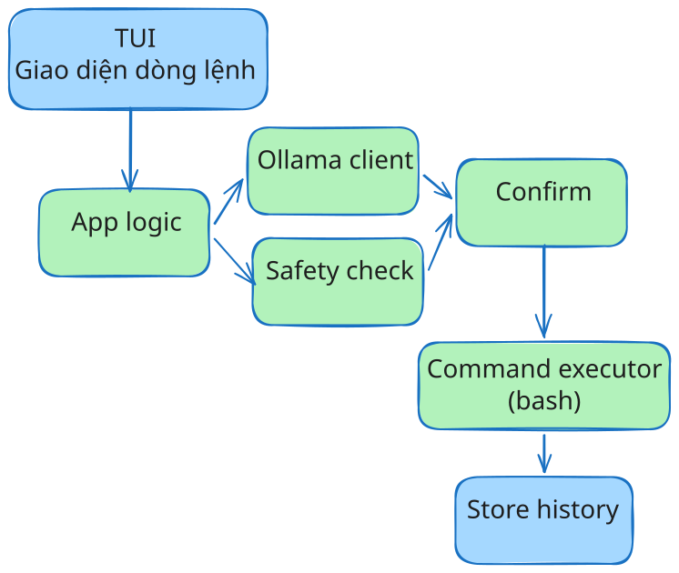

# PROJECT PROPOSAL

> **Môn học:** Nhập môn Công nghệ Phần mềm\
> **Đơn vị:** Bộ môn Công nghệ Phần mềm -- Khoa Công nghệ Thông tin,
> Trường Đại học Khoa học Tự nhiên, ĐHQG-HCM\
> **Tên đề tài:** EZcli\
> **Mã nhóm / Lớp:** Nhóm 09 - 2024/3\
> **Giảng viên hướng dẫn:** TS. Ngô Ngọc Đăng Khoa

## 1. THÔNG TIN DỰ ÁN & ĐÁNH GIÁ THÀNH VIÊN

### 1.1. Danh sách thành viên & Phân công vai trò

| STT | MSSV | Họ và Tên | Vai trò chính trong dự án | % Đóng góp dự kiến |
| :---: | :---: | :--- | :--- | :---: |
| 1 | 24120306 | **Nguyễn Duy Hào** | **Trưởng nhóm** | 100% |
| 2 | 24120304 | **Trần Thị Bích Hạnh** | Phát triển & Tài liệu | 100% |
| 3 | 24120299 | **Nguyễn Thị Ngọc Hà** | TUI / UX | 100% |
| 4 | 24120044 | **Bùi Thị Thùy Dương** | Kiểm thử & Safety | 100% |

### 1.2. Công cụ và quy trình làm việc

Nhóm áp dụng Scrum với Sprint kéo dài một tuần. Daily Standup được tổ
chức ba ngày một lần, trực tuyến, khoảng 15 phút. Nhóm có Sprint
Planning, Sprint Review và Sprint Retrospective.

Công cụ sử dụng:

- **Quản lý task:** Trello, Notion.
- **Quản lý mã nguồn:** Git, Github.
- **CI:** GitHub Actions.
- **Nhánh chính:** `main`, `develop`.
- **Nhánh công việc:** `feat/*`, `fix/*`.

## 2. PHÁT BIỂU BÀI TOÁN & PHẠM VI DỰ ÁN

### 2.1. Bối cảnh & Phát biểu bài toán

`CLI` là công cụ thường được sử dụng trong phát triển phần mềm và quản trị
hệ thống. Tuy nhiên, người dùng phải **nhớ** cú pháp, tham số và tùy chọn
của nhiều lệnh khác nhau. Khi gặp tác vụ ít sử dụng hoặc phức tạp, người
dùng thường phải **tra cứu tài liệu** hoặc **hỏi công cụ AI** bên ngoài
terminal.

Việc sử dụng `LLM` để sinh `command` cũng có **rủi ro**: command được sinh có
thể không phù hợp với shell hiện tại hoặc có thể gây ảnh hưởng đến dữ
liệu và hệ thống nếu được thực thi mà không kiểm tra.

EZcli được đề xuất như một `TUI` chạy **cục bộ** trên Linux, sử dụng `LLM` cục
bộ thông qua `Ollama` để chuyển yêu cầu bằng ngôn ngữ tự nhiên thành `Bash
command`. Trước khi thực thi, hệ thống hiển thị command, kiểm tra các
rule an toàn và yêu cầu người dùng xác nhận.

### 2.2. Vấn đề cần giải quyết

1. Người dùng phải **chuyển đổi** giữa terminal và tài liệu/công cụ AI khi
   cần tìm command.
2. Người dùng có thể gặp khó khăn khi **nhớ** cú pháp hoặc tham số của
   command.
3. `Command` do `LLM` sinh có thể không phù hợp với `context` hiện tại hoặc
   có thể chứa **thao tác nguy hiểm**.
4. Người dùng muốn sử dụng `LLM` cục bộ thay vì phụ thuộc vào `cloud API`
   cho chức năng sinh command.

### 2.3. Mục tiêu dự án

- Xây dựng TUI cho phép người dùng nhập yêu cầu bằng ngôn ngữ tự
  nhiên.
- Sử dụng `qwen2.5-coder:3b` thông qua Ollama để sinh Bash command.
- Thu thập context cần thiết của môi trường hiện tại để hỗ trợ quá
  trình sinh command.
- Kiểm tra command bằng tập rule an toàn trước khi thực thi.
- Luôn yêu cầu người dùng xác nhận trước khi execute.
- Cho phép giải thích command.
- Lưu lịch sử thao tác cục bộ.
- Đảm bảo các chức năng cốt lõi không phụ thuộc Internet.

### 2.4. Stakeholder

| Mã | Bên liên quan | Vai trò | Nhu cầu chính | Mức độ ảnh hưởng |
| :---: | :--- | :--- | :--- | :---: |
| `STK-01` | Người dùng ít kinh nghiệm | Người dùng cuối | Nhập **mô tả tự nhiên** và nhận command mà không cần **nhớ toàn bộ cú pháp**. | Cao |
| `STK-02` | Lập trình viên nâng cao | Người dùng | Sinh và **giải thích command**, thực thi trực tiếp, sử dụng lịch sử và alias. | Cao |
| `STK-03` | Giảng viên | Người đánh giá | Đánh giá tính khả thi, chất lượng kỹ thuật và mức độ hoàn thiện của đồ án. | Cao |
| `STK-04` | Nhóm phát triển | Đội ngũ kỹ thuật | Hiện thực, **kiểm thử** và tài liệu hóa hệ thống. | Cao |

### 2.5. Phạm vi dự án

#### Trong phạm vi MVP --- Must Have

- TUI.
- Sinh Bash command từ ngôn ngữ tự nhiên.
- Nhận diện context cần thiết của môi trường.
- Safety checking bằng rule/regex.
- Cảnh báo và yêu cầu xác nhận trước khi thực thi.
- Block các command thuộc nhóm rule được định nghĩa là không cho phép
  thực thi.
- Execute command trực tiếp trong EZcli.
- Giải thích command.
- Lưu lịch sử cục bộ.

#### Should Have

- Alias.
- Bổ sung shell context cho quá trình sinh command.

#### Could Have

- Tìm kiếm mờ lịch sử.
- Tra cứu tldr.
- Tra cứu cheat.sh.
- Hỗ trợ shell khác Bash.
- Hỗ trợ hệ điều hành khác Linux.

Các chức năng Could Have không được xem là điều kiện bắt buộc để nghiệm
thu MVP.

#### Ngoài phạm vi

- Cloud LLM hoặc tự động chuyển request lên API AI bên ngoài.
- Remote command execution.
- Tự động sửa command sau khi command thực thi thất bại.
- Hỗ trợ arbitrary shell.
- Đăng ký global hotkey trên hệ điều hành.

### 2.6. Bảng thuật ngữ

| Thuật ngữ | Giải nghĩa |
| :--- | :--- |
| `CLI` | Command-Line Interface, giao diện tương tác với hệ điều hành bằng command. |
| `TUI` | Terminal User Interface, giao diện tương tác hiển thị trong terminal. |
| `Shell` | Chương trình tiếp nhận và phân tích command để yêu cầu hệ điều hành thực thi. |
| `LLM` | Large Language Model, mô hình ngôn ngữ lớn được sử dụng để xử lý yêu cầu tự nhiên và sinh command. |
| `LLM cục bộ` | LLM chạy trực tiếp trên máy người dùng thông qua runtime cục bộ. |
| `Ollama` | Runtime được sử dụng để chạy và giao tiếp với local LLM. |
| `Safety rule` | Rule dùng để xác định command có khả năng gây ảnh hưởng đến dữ liệu hoặc hệ thống. |
| `DoD` | Definition of Done, tiêu chí để xác định một task đã hoàn thành. |

## 3. SO SÁNH & ĐÁNH GIÁ CÁC GIẢI PHÁP HIỆN TẠI

### 3.1. Các hướng tiếp cận hiện tại

#### Tra cứu tài liệu hoặc hỏi AI bên ngoài terminal

Người dùng có thể tìm command trên tài liệu trực tuyến hoặc hỏi công cụ
AI. Cách này có thể làm gián đoạn thao tác terminal và yêu cầu người
dùng sao chép thông tin giữa các ứng dụng.

#### Công cụ tìm kiếm lịch sử command

Các công cụ như `fzf` hỗ trợ tìm lại command đã từng xuất hiện trong
history. Tuy nhiên, cách tiếp cận này chủ yếu hỗ trợ tìm command đã có,
không sinh command mới từ yêu cầu tự nhiên.

#### Shell GPT

Nhóm tham khảo `shell_gpt` thông qua repository và README của dự án.
Shell GPT cung cấp chức năng sinh và giải thích command trong terminal.
EZcli tập trung vào việc xây dựng giao diện TUI và độ an toàn.

#### Warp

Nhóm tham khảo Warp thông qua trang/repository tài liệu được sử dụng
trong quá trình khảo sát. Warp cung cấp terminal tích hợp AI. EZcli tập
trung vào một ứng dụng Linux local-first với local LLM và không sử dụng
cloud LLM trong phạm vi dự án.

### 3.2. Bảng so sánh

| Tiêu chí | Hỏi AI bên ngoài terminal | Shell GPT | Warp | EZcli |
| :--- | :--- | :--- | :--- | :--- |
| Sinh command từ ngôn ngữ tự nhiên | Có | Có | Có | Có |
| Tích hợp workflow terminal | Thấp | Có | Có | Có |
| Local LLM | Phụ thuộc dịch vụ | Có thể cấu hình tùy môi trường | Ngoài scope của EZcli | Có |
| Xử lý core request cục bộ | Không | Có thể | Không phải mục tiêu của EZcli | Có |
| Safety checking trước execution | Không phải workflow chính | Có confirmation | Có cơ chế hỗ trợ execution | Có rule-based checking |
| Confirmation trước execution | Phụ thuộc công cụ | Có | Có | Bắt buộc |
| Command execution trong ứng dụng | Không | Có | Có | Có |
| Target platform của đề tài | --- | --- | --- | Linux + Bash |
| Lịch sử cục bộ | Phụ thuộc công cụ | Có | Có | Có |

### 3.3. Điểm khác biệt của EZcli

EZcli tập trung vào ba đặc điểm:

1. **Local-first:** LLM và các chức năng cốt lõi chạy trên máy người
   dùng thông qua Ollama.
2. **Safety trước execution:** command được kiểm tra theo rule trước
   khi thực thi và luôn yêu cầu xác nhận.
3. **Tích hợp workflow:** người dùng có thể sinh, xem, giải thích, xác
   nhận và thực thi command ngay trong TUI.
4. **Thân thiện người dùng:** giao diện TUI đẹp mắt kết hợp hỗ trợ bởi AI.

## 4. GIẢI PHÁP ĐỀ XUẤT & ĐẶC TẢ YÊU CẦU PHẦN MỀM (SRS)

### 4.1. User Stories

| ID | User story | Yêu cầu liên quan |
| :---: | :--- | :--- |
| `US-01` | Là người dùng, tôi muốn mô tả tác vụ bằng ngôn ngữ tự nhiên để nhận được Bash command tương ứng. | `FR-01`, `FR-02` |
| `US-02` | Là người dùng, tôi muốn xem command trước khi chạy để kiểm tra kết quả sinh ra. | `FR-03` |
| `US-03` | Là người dùng, tôi muốn được cảnh báo trước các command nguy hiểm. | `FR-04` |
| `US-04` | Là người dùng, tôi muốn xác nhận trước khi command được thực thi. | `FR-05` |
| `US-05` | Là người dùng, tôi muốn giải thích command để hiểu ý nghĩa của từng thành phần. | `FR-06` |
| `US-06` | Là người dùng, tôi muốn xem lại các thao tác trước đó từ lịch sử cục bộ. | `FR-07` |
| `US-07` | Là người dùng, tôi muốn tạo alias cho command thường dùng. | `FR-08` |

### 4.2. Danh mục yêu cầu chức năng

| Mã | Chức năng | Mô tả | Ưu tiên | Tiêu chí nghiệm thu |
| :---: | :--- | :--- | :---: | :--- |
| `FR-01` | Nhập yêu cầu tự nhiên | TUI tiếp nhận mô tả tác vụ bằng ngôn ngữ tự nhiên. | Must | Input hợp lệ được chuyển vào pipeline xử lý. |
| `FR-02` | Sinh Bash command | Hệ thống sử dụng local LLM để sinh Bash command dựa trên yêu cầu và context đã thu thập. | Must | Command được hiển thị và thuộc cú pháp Bash trong các test case đã định nghĩa. |
| `FR-03` | Hiển thị command | TUI hiển thị command được sinh trước khi thực thi. | Must | Người dùng có thể xem command trước khi chọn hành động. |
| `FR-04` | Safety checking | Hệ thống kiểm tra command bằng tập rule/regex đã định nghĩa và phân loại kết quả. | Must | Command thuộc một rule nguy hiểm được cảnh báo hoặc block theo mức của rule. |
| `FR-05` | Xác nhận trước execution | Hệ thống yêu cầu người dùng xác nhận trước mọi command execution. | Must | Command không được execute nếu người dùng chọn hủy. |
| `FR-06` | Giải thích command | Hệ thống giải thích cấu trúc, option và tham số của command khi người dùng yêu cầu. | Must | TUI hiển thị phần giải thích tương ứng với command đang xem. |
| `FR-07` | Lịch sử thao tác | Hệ thống lưu prompt, command, timestamp, safety result và execution status cục bộ. | Must | Dữ liệu được lưu và có thể đọc lại sau khi khởi động lại ứng dụng. |
| `FR-08` | Alias | Hệ thống cho phép tạo và quản lý alias cho command thường dùng. | Should | Alias được lưu cục bộ và có thể được sử dụng lại. |
| `FR-09` | Shell context | Hệ thống thu thập context liên quan như shell và thư mục hiện tại để hỗ trợ sinh command. | Should | Context được truyền vào pipeline sinh command. |
| `FR-10` | Fuzzy history search | Hệ thống tìm command gần khớp trong history. | Could | Tìm được các entry phù hợp với từ khóa kiểm thử. |
| `FR-11` | Knowledge lookup | Hệ thống có thể tra cứu tldr/cheat.sh khi người dùng yêu cầu. | Could | Hiển thị kết quả khi Internet khả dụng; core functionality không phụ thuộc chức năng này. |

### 4.3. Yêu cầu phi chức năng

| Mã | Nhóm | Yêu cầu | Phương pháp kiểm chứng |
| :---: | :--- | :--- | :--- |
| `NFR-01` | Hiệu năng | Hệ thống **target** thời gian sinh command ≤ 1 giây đối với request điển hình/đơn giản trên _reference environment_. Request phức tạp có thể mất nhiều thời gian hơn. | Đo thời gian từ lúc gửi request đến khi command được trả về trên tập input được định nghĩa trước. |
| `NFR-02` | Local processing | Core command generation và safety checking được xử lý cục bộ; không sử dụng cloud LLM. | Kiểm tra cấu hình/runtime và network dependency của core flow. |
| `NFR-03` | Safety | Safety checker phải phát hiện các command thuộc tập rule **nguy hiểm** đã định nghĩa. | Unit/integration tests trên safety rule dataset. |
| `NFR-04` | Execution safety | Mọi command đều yêu cầu confirmation trước execution; command thuộc nhóm `blocked` không được execute. | Integration test với safe, warning và blocked command. |
| `NFR-05` | Platform | MVP target Linux và Bash. | Chạy test suite trên môi trường Linux/Bash được thống nhất. |
| `NFR-06` | Data storage | History và configuration được lưu cục bộ dưới dạng JSON. | Kiểm tra file storage và khả năng đọc lại dữ liệu sau khi restart. |
| `NFR-07` | Reliability | Lỗi từ LLM, file storage hoặc command execution phải được xử lý và hiển thị thay vì làm ứng dụng kết thúc ngoài dự kiến. | Integration test các trường hợp lỗi. |
| `NFR-08` | Maintainability | Core logic được tổ chức thành các module có thể kiểm thử độc lập và được kiểm tra bằng pytest. | Code review và automated test. |

### 4.4. Đặc tả kịch bản sử dụng

_Mỗi kịch bản mô tả luồng chính và các trường hợp rẽ nhánh quan trọng._

#### Kịch bản 1: Sinh và thực thi command (`SC-01`)

- **Tác nhân:** Người dùng.
- **Tiền điều kiện:** EZcli và Ollama đã được cài đặt; local model sẵn
  sàng.
- **Kích hoạt:** Người dùng nhập yêu cầu bằng ngôn ngữ tự nhiên.

**Luồng chính:**

1. Người dùng nhập yêu cầu.
2. EZcli thu thập context cần thiết.
3. EZcli gửi request tới local LLM thông qua Ollama.
4. TUI hiển thị command được sinh.
5. Safety checker kiểm tra command.
6. TUI hiển thị kết quả kiểm tra và các hành động khả dụng.
7. Người dùng chọn thực thi.
8. EZcli yêu cầu confirmation.
9. Nếu được xác nhận, command được thực thi qua Bash.
10. EZcli hiển thị stdout/stderr và execution status.
11. EZcli lưu thông tin vào history.

**Rẽ nhánh / Ngoại lệ:**

- **7b**:Người dùng chọn **Giải thích** → hiển thị giải thích command, sau đó
  quay lại màn hình hành động.
- **7c**:Người dùng chọn **Hủy** → không execute và trả quyền điều khiển cho
  TUI.
- Safety checker trả về `warning` → hiển thị cảnh báo và yêu cầu
  confirmation.
- Safety checker trả về `blocked` → không cho phép execute.
- Ollama không khả dụng → hiển thị lỗi và không thực thi command.
- Execution thất bại → hiển thị exit status và output lỗi; hệ thống
  không tự sửa hoặc chạy lại command.

**Hậu điều kiện:** Command được execute sau confirmation, hoặc không
được execute nếu người dùng hủy hoặc command bị block.

#### Kịch bản 2: Quản lý history và alias (`SC-02`)

- **Tác nhân:** Người dùng.
- **Tiền điều kiện:** EZcli có quyền đọc/ghi storage cục bộ.
- **Luồng chính:**
  1. Người dùng mở history hoặc alias.
  2. Người dùng chọn entry hoặc nhập tên alias.
  3. EZcli đọc dữ liệu JSON.
  4. TUI hiển thị kết quả.
  5. Người dùng tạo/sửa alias nếu cần.
  6. EZcli kiểm tra và lưu dữ liệu.

**Rẽ nhánh / Ngoại lệ:**

- Không tìm thấy entry → thông báo và cho phép tìm lại.
- Alias đã tồn tại → yêu cầu xác nhận trước khi ghi đè.
- Không thể ghi file → thông báo lỗi và giữ dữ liệu hiện tại.

### 4.5. Kiến trúc tổng thể phần mềm & Công nghệ đề xuất

EZcli sử dụng kiến trúc local-first. Core application chạy trên máy
người dùng và không cần server riêng.

**Công nghệ chính:**

| Thành phần | Công nghệ |
| :--- | :--- |
| Language | Python |
| TUI | Textual |
| LLM | `qwen2.5-coder:3b` |
| LLM runtime | Ollama |
| Safety | Rule/regex matching |
| Execution | Python `subprocess` → Bash |
| Storage | JSON |
| Testing | pytest |
| CI | GitHub Actions |

### 4.6. Yêu cầu môi trường & Phần cứng

EZcli không yêu cầu máy chủ riêng.

**Reference development environment:**

| Thành phần | Cấu hình |
| :--- | :--- |
| CPU | Intel Core i5 |
| RAM | 16 GB |
| GPU | 4 GB VRAM |
| Storage | 512 GB |
| OS | Linux |
| Shell | Bash |

EZcli đã được nhóm kiểm thử trên môi trường tham chiếu này với local
model đã chọn. Cấu hình trên được dùng làm **reference environment**,
không được xem là mức phần cứng tối thiểu của hệ thống.

**Internet:** Không bắt buộc cho core functionality. Các chức năng tra
cứu tldr/cheat.sh nếu được triển khai yêu cầu Internet.

## 5. KẾ HOẠCH PHÁT TRIỂN THEO MÔ HÌNH SCRUM

### 5.1. Thiết lập quy trình phát triển

Nhóm áp dụng Scrum với Sprint kéo dài một tuần.

- **Sprint Planning:** đầu mỗi Sprint.
- **Daily Standup:** ba ngày một lần, trực tuyến, khoảng 15 phút.
- **Sprint Review:** cuối Sprint.
- **Sprint Retrospective:** cuối Sprint, sau Review.
- **Task management:** Trello và Notion.
- **Definition of Done:** task được code/review, có test phù hợp, chạy
  được trên môi trường mục tiêu và tài liệu liên quan được cập nhật.

Mỗi task được gắn với FR/NFR hoặc một hạng mục tài liệu và có trạng thái
`To Do`, `In Progress`, `Review`, `Done`.

### 5.2. Lộ trình phát triển

| Giai đoạn | Thời gian | Mục tiêu | Sản phẩm |
| :--- | :--- | :--- | :--- |
| **Proposal** | 05/10 -- trước 10/10 | Hoàn thiện proposal + Mini-SRS | Proposal/Mini-SRS |
| **Sprint 1** | 11/10 -- 17/10 | Khởi tạo project, TUI skeleton, Ollama integration, context collection | Prototype chạy được |
| **Sprint 2** | 18/10 -- 24/10 | NL → command, explain, confirmation, execution | Core workflow |
| **Sprint 3** | 25/10 -- 31/10 | Safety checker, history, alias và các chức năng được ưu tiên | MVP tích hợp |
| **Sprint 4** | 1/11 -- 2/11 | Integration testing, sửa lỗi, hoàn thiện UX và packaging. Regression test, hoàn thiện tài liệu và chuẩn bị vấn đáp | Release candidate |

### 5.3. Quy trình tiếp nhận & xử lý thay đổi yêu cầu

1. **Tiếp nhận:** ghi nhận thay đổi và lý do.
2. **Phân tích tác động:** đánh giá ảnh hưởng đến scope, requirement,
   code và tiến độ.
3. **Quyết định:** trưởng nhóm và các thành viên thống nhất mức ưu
   tiên.
4. **Cập nhật:** cập nhật requirement, task và traceability matrix nếu
   thay đổi được chấp nhận.

Thay đổi làm tăng đáng kể scope phải được ưu tiên sau các Must Have của
MVP.

### 5.4. Ma trận truy vết yêu cầu

| Mã nhu cầu | Stakeholder | Requirement | Scenario | Test |
| :---: | :--- | :--- | :---: | :--- |
| `N-01` | `STK-01`, `STK-02` | `FR-01`, `FR-02`, `FR-09` | `SC-01` | `TC-01`, `TC-02` |
| `N-02` | `STK-01`, `STK-02` | `FR-03`, `FR-04`, `FR-05` | `SC-01` | `TC-03` |
| `N-03` | `STK-01`, `STK-02` | `FR-06`, `FR-07`, `FR-08` | `SC-02` | `TC-04` |
| `N-04` | `STK-03`, `STK-04` | `NFR-01` -- `NFR-08` | `SC-01`, `SC-02` | `TC-05`, `TC-06` |
| `N-05` | `STK-02` | `FR-10`, `FR-11` | `SC-02` | `TC-07`, `TC-08` (nếu triển khai) |

## 6. KẾ HOẠCH NHÂN SỰ & NGÂN SÁCH DỰ KIẾN

### 6.1. Phân bổ trách nhiệm (RACI)

> **R** --- thực hiện chính; **A** --- chịu trách nhiệm; **C** --- tham
> vấn; **I** --- được thông báo.

| Hạng mục | Hào | Hạnh | Hà | Dương |
| :--- | :---: | :---: | :---: | :---: |
| Yêu cầu, scope và điều phối nhóm | A/R | C | C | C |
| Proposal & Mini-SRS | A | R | R | C |
| TUI / UX | C | C | A/R | C |
| LLM integration & command pipeline | A/R | R | C | C |
| Context collection | A/R | C | C | R |
| Safety checker | A | C | C | R |
| History / Alias | C | R | A/R | C |
| Testing | A | C | R | R |
| CI / repository | A/R | C | C | R |
| Review & integration | A/R | R | R | R |
| Tài liệu bàn giao / vấn đáp | A | R | R | R |

### 6.2. Dự toán ngân sách

| Danh mục | Số lượng | Chi phí dự kiến | Ghi chú |
| :--- | :---: | :---: | :--- |
| Máy tính phát triển/kiểm thử | 4 | 0 VNĐ | Sử dụng thiết bị sẵn có |
| Ollama và local model | 1 bộ | 0 VNĐ | Sử dụng trong phạm vi đồ án |
| Thư viện phần mềm | 1 bộ | 0 VNĐ | Sử dụng thư viện phù hợp với giấy phép |
| GitHub / CI | 1 | 0 VNĐ | Sử dụng gói miễn phí |
| Trello / Notion | 1 | 0 VNĐ | Sử dụng gói hiện có |
| Cloud VPS | 0 | 0 VNĐ | Không sử dụng |
| Domain | 0 | 0 VNĐ | Không sử dụng |
| **Tổng** | | **0 VNĐ** | |

## 7. KIỂM NGHIỆM YÊU CẦU & KỊCH BẢN KIỂM THỬ

### 7.1. Tiêu chí kiểm nghiệm yêu cầu

Trước khi implement, nhóm kiểm tra requirement theo các tiêu chí:

- **Đúng:** giải quyết vấn đề đã xác định.
- **Đầy đủ:** có input, behavior và expected result cần thiết.
- **Nhất quán:** không mâu thuẫn với requirement hoặc architecture
  khác.
- **Kiểm chứng được:** có cách test hoặc đo.
- **Khả thi:** phù hợp scope, thời gian và môi trường của nhóm.

### 7.2. Kịch bản kiểm thử mẫu

| ID | Requirement | Mục đích | Input | Expected result |
| :---: | :--- | :--- | :--- | :--- |
| `TC-01` | `FR-01`, `FR-02`, `FR-09` | Kiểm tra sinh command | `list files in current directory` | Hệ thống trả về một Bash command hợp lệ cho context hiện tại và hiển thị trên TUI. |
| `TC-02` | `FR-02`, `NFR-01` | Kiểm tra latency | Tập request đơn giản đã định nghĩa | Request điển hình đạt target ≤ 1 giây trên reference environment; kết quả đo được ghi nhận. |
| `TC-03` | `FR-04`, `FR-05`, `NFR-04` | Kiểm tra safety + confirmation | Command thuộc safety rule dataset | Hệ thống cảnh báo hoặc block theo rule; không execute nếu chưa được xác nhận. |
| `TC-04` | `FR-07`, `FR-08` | Kiểm tra history/alias | Prompt và command mẫu | History được lưu vào JSON; alias được tạo và đọc lại thành công. |
| `TC-05` | `NFR-02`, `NFR-05` | Kiểm tra local processing/platform | Chạy core flow trên Linux/Bash | Core flow sử dụng local LLM và chạy trên target environment. |
| `TC-06` | `NFR-06`, `NFR-07`, `NFR-08` | Kiểm tra storage/error handling | File storage lỗi hoặc Ollama không khả dụng | Hệ thống hiển thị lỗi phù hợp, không crash ngoài dự kiến và không làm mất dữ liệu hiện có. |

### 7.3. Safety test policy

Không thực thi command phá hoại thật trong test.

Ví dụ `rm -rf /` chỉ được dùng như **chuỗi đầu vào cho safety checker**
hoặc fixture của unit test. Test phải kiểm tra kết quả phân loại mà
không chuyển command đó tới Bash.

Safety dataset được xây dựng theo các nhóm rule đã định nghĩa, ví dụ:

- Recursive/destructive file deletion.
- Disk/filesystem operations.
- System shutdown/reboot.
- Permission changes có rủi ro cao.
- Các command/pipeline được nhóm xác định là nguy hiểm.

## 8. RỦI RO & GIỚI HẠN

| Rủi ro | Ảnh hưởng | Biện pháp |
| :--- | :---: | :--- |
| LLM sinh command không phù hợp | Cao | Context + hiển thị command + explanation + confirmation |
| LLM hallucination | Cao | Không tự động execute; safety checking và user confirmation |
| Safety rule bỏ sót pattern | Cao | Xây dựng rule dataset và kiểm thử riêng; không claim phát hiện mọi command nguy hiểm |
| Local model chạy chậm với request phức tạp | Trung bình | Target ≤1s chỉ áp dụng request điển hình/đơn giản; đo trên reference environment |
| Ollama/model không khả dụng | Cao | Hiển thị lỗi và không execute command |
| Khác biệt shell | Trung bình | MVP chỉ target Linux + Bash |
| Online lookup không khả dụng | Thấp | Không ảnh hưởng core functionality |
